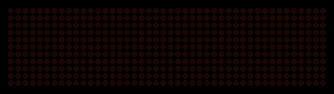

# led-banner

LED ネームバッジ風の電光掲示板（LED バナー）を作って、アニメーション GIF として保存したり、SNS に共有したりできる Web アプリです。

**▶ https://mitsuharu.github.io/led-banner/**



このアプリで作った GIF です（左スクロール・赤・LED 中）。

## このアプリについて

[LEDネームバッジ 書き換えツール（led-name-badge）](https://github.com/mitsuharu/led-name-badge) のスピンオフです。バッジへの書き込み部分を省き、プレビューを主役にしました。

- **バッジがなくても使える**: 横 44 × 縦 11 ドットの [LEDネームバッジ（Shigezone）](https://www.shigezone.com/p/p916/) の見た目と動きを、ブラウザの中で再現します。
- **インストール不要**: URL を開くだけで使えます。スマートフォンでも動きます。
- **外部に送信しない**: 入力した文字や設定はブラウザ（localStorage）にだけ保存し、サーバーには送りません。外部に届くのは、「共有…」で選んだ共有先から自分で送ったときだけです。

## 使い方

1. https://mitsuharu.github.io/led-banner/ を開く
2. 文字列を入力し、表示モード・速度・色などを選ぶ（フォント設定やドット編集で細かく直すことも可）
3. 「共有…」で X などのアプリに GIF を添付して投稿、または「GIF を保存」でダウンロード

### 機能

- 表示モード 9 種（左/右/上/下スクロール、固定、アニメ、降ってくる、カーテン、レーザー）、速度 1〜8、点滅、枠アニメ
  - 動きは led-name-badge のプレビューと同じ。スクロール・固定は実機と同じ動き、降ってくる・カーテン・レーザーはおおよその動き（画面にもその旨を表示する）
- LED の色 7 種（赤・橙・黄・緑・青・白・ピンク。実際のバッジの色に合わせた）、明るさ 4 段階
- 端末のフォントで日本語を 11 ドットに変換＋ドット編集（しきい値は数値も表示。小さいほど線が太くなる）
  - フォントは端末に入っているものを使う（Web フォントは読み込まない）。既定の「ゴシック」は、Windows では MS ゴシック、iPhone・Mac ではヒラギノ、Android では Noto のように、端末にあるものを順に使う
- プレビューの一時停止。止めたまま文字列やフォントを変えると、止めた画面のまま描き直す
- アニメーション GIF の保存
  - 画面のプレビューと同じ描画で作るので、見たままの GIF になる
  - 画像はドットのエリアと、周りの LED 1 個分の余白だけ
  - LED の大きさ（GIF の解像度）を選べる。ファイルが大きすぎるときは小さくする
  - 動きが一巡するとちょうど最初に戻るよう、GIF の長さを決める（点滅・枠アニメの周期も揃える。揃えると 60 秒を超えるときは動きの一巡だけに合わせる）
- 共有（主な使い道はスマートフォン）
  - 「共有…」: ファイルの共有（Web Share API）に対応したブラウザでは、これをメインのボタンにする。共有シートで X などのアプリを選ぶと、GIF を添付した状態で投稿画面になる
  - 共有する文は自由入力（空なら空のまま）。「表示する文字列を共有する文に入れる」にチェックすると、表示する文字列を前に足す
  - 共有に対応しないブラウザでは「共有…」と共有する文の欄を出さず、「GIF を保存」だけにする
  - X 専用の投稿ボタンは置かない。X の投稿画面の URL では画像を渡せず、API で投稿するには X アカウントの認可を預かるサーバーが要るため
- ダーク／ライト／OS に合わせる のテーマ切り替え（初期値はダーク）

## 対応環境

最新の Chrome / Edge / Safari / Firefox（パソコン・スマートフォン）。

「共有…」はファイルの共有に対応したブラウザ（iPhone / Android の主なブラウザ、Windows・macOS の Chrome / Edge / Safari など）でだけ表示します。

## 開発

依存ライブラリもビルド工程もありません。GIF のエンコーダも自前です（`src/gif.js`）。ルールは [AGENTS.md](AGENTS.md) を参照してください。

```sh
node --test                 # 動き・描画・GIF のテスト
python3 -m http.server 8000 # http://localhost:8000/ で開く（ES Modules のため file:// では動かない）
```

| ファイル | 役割 |
| --- | --- |
| `src/preview.js` | 表示モードの 1 コマ（44×11 の点灯状態）を計算する。led-name-badge と同じ |
| `src/raster.js` | 点灯状態を、丸い LED が並んだ画像（3 色のパレットの番号）にする。プレビューと GIF で共用 |
| `src/animation.js` | 動きを GIF のコマと表示時間の並びにする |
| `src/gif.js` | アニメーション GIF のエンコーダ（LZW、変わった範囲だけを書く差分） |
| `src/share.js` | 共有する文を作る |
| `src/app.js` | 画面の操作・文字の描画・保存と共有 |

## 注意

非公式ツールです。Shigezone やバッジのメーカー、X とは関係のない個人のツールです。

## License

MIT
